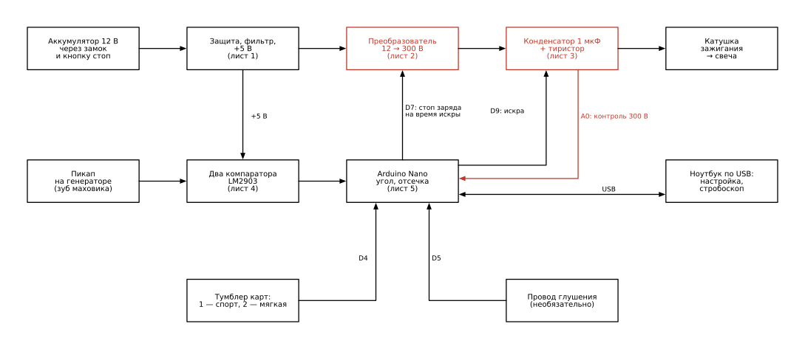
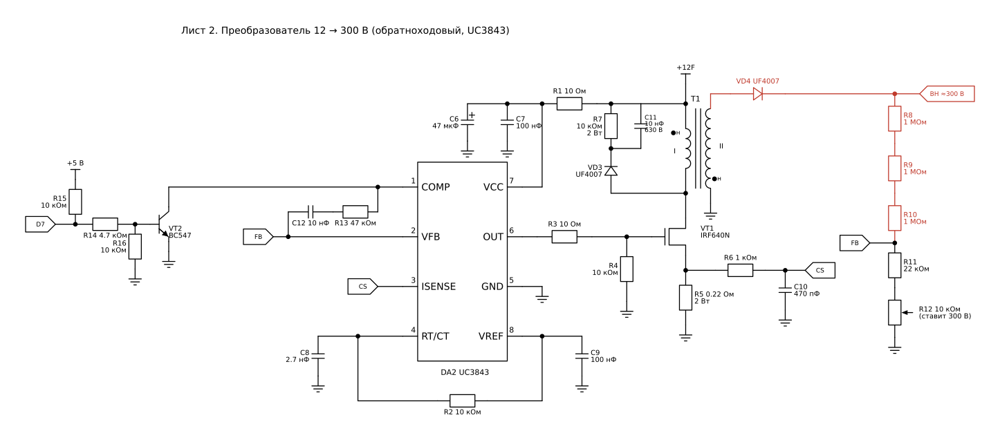
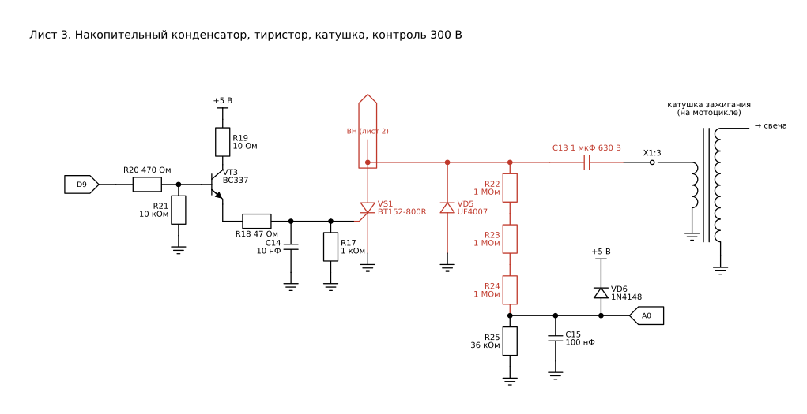

# MH-CDI 174 — своё спортивное зажигание для Zongshen 174MN-3 (CBS300)

Программируемый коммутатор (DC-CDI) на Arduino Nano. Ставится вместо штатного коммутатора с двумя
фишками (4+2) на мотор **Zongshen ZS174MN-3 / CBS300** (276 см³, жидкостное охлаждение, балансир):
Avantis A3 / A6 Lux 300, BSE Z7 300 (вариант с 174MN-3), Motoland FX 300 / XT300 ST / X3 300W PRO,
Progasi Gaudi 300, Promax Adventure 300 PRO, PWR FR300 PRO, Regulmoto Fargo 300, Zuumav CBS 300 Pro,
ЗиД 300-01 «Стайер» и любые другие с этим мотором.

Того же класса, что и спортивные коммутаторы вроде зелёного UP X: питание от аккумулятора, раннее
зажигание на средних оборотах, поднятая отсечка. Отличия: угол и отсечку настраиваешь сам
с ноутбука, карт две и переключаются тумблером на ходу, а угол проверяется стробоскопом.

| Папка / файл | Что внутри |
|---|---|
| `schematic/*.svg` | Принципиальная схема: блок-схема и 5 листов |
| `schematic/draw.py` | Скрипт, который рисует схему (schemdraw) — правки схемы делать в нём |
| `firmware/sport_cdi/` | Прошивка для Arduino IDE: `sport_cdi.ino` + `cdi_core.h` (логика) + `cdi_logic.h` (арифметика) |
| `firmware/test/` | Проверки прошивки на компьютере и на эмуляторе ATmega328P |

> **Что проверено, а что нет.** Прошивка проверена: 99 проверок логики на «виртуальном моторе» и прогон
> настоящего `.hex` на эмуляторе ATmega328P (углы совпадают с картой в пределах 0.2° на 2000–9500 об/мин,
> работают отсечка, пуск, глушение, две карты, авария по напряжению, стендовый режим). Силовая часть
> (преобразователь, трансформатор) **рассчитана, но железом пока не собиралась** — первый запуск только на
> столе, от блока питания с ограничением тока, по разделу «Первый запуск на столе».

---

## ⚠ Безопасность

- Внутри **300 В**. Конденсатор C13 хранит ≈ 45 мДж — удар током болезненный, через сердце опасный.
  Плату под питанием руками не трогать. После выключения подождать 30 с и разрядить C13 отвёрткой через
  резистор 1 кОм 2 Вт (делители R8–R12 и R22–R25 сами разряжают его за несколько секунд, но проверяй).
- **Никогда не давай искру «в воздух»**: свеча — в колпачке и прижата к массе мотора, или разрядник.
  Без нагрузки катушка пробивает сама себя изнутри.
- Первый раз — только от лабораторного блока питания 12–14 В с ограничением тока 1.5–2 А, не от аккумулятора.
- Слишком ранний угол = детонация = прогар поршня. Таблицу поднимай по 1–2°, слушай мотор под нагрузкой.
- Отсечку выше 10 000 об/мин ставишь на свой риск: клапанные пружины и балансир у CBS300 под это не задумывались.
- Возить с собой штатный коммутатор — замена за минуту.

---

## Что умеет

- **Угол опережения по таблице** из 15 точек (1000…11 000 об/мин), между точками — плавно.
  **Две карты**: 1 — «спорт» (АИ-95/98), 2 — «мягкая» (АИ-92, жара, сомнительный бензин). Переключаются тумблером
  SA1 прямо на ходу.
- **Отсечка** 3000–12 000 об/мин: жёсткая (все искры пропадают, с отстрелами — как у спортивных коммутаторов)
  или мягкая (сначала пропадает каждая вторая искра, через +200 об/мин — все).
- **Пуск — по заднему краю зуба маховика**, как у штатного: поздний угол, нет обратного удара по стартеру.
- **Безопасен по умолчанию**: пока угол переднего края зуба не измерен стробоскопом, искра всегда идёт по заднему
  краю (как штатный на малых оборотах) — мотор заводится и едет, но вяло. Таблица включается после калибровки.
- **Калибровка стробоскопом** (`cal`, `lead`, `fix`), поправку на задержку прошивка считает сама.
- **Защиты**: мотор стоит дольше 0.5 с — преобразователь выключен (300 В на стоящем моторе не висят);
  напряжение выше 370 В — авария, преобразователь выключается; помехи в проводе пикапа отбрасываются;
  на время искры преобразователь всегда остановлен (тиристор надёжно закрывается).
- **Полярность пикапа — любая**: прошивка сама определяет, какой импульс передний.
- **Стендовый режим** `test 3000` — искры без мотора, проверить блок на столе.
- Настройки — по USB с ноутбука (Arduino IDE → «Монитор порта»), хранятся в памяти Nano.

### А «как зелёный UP X»?

Точных данных о зелёном коммутаторе UP X (кривая угла, обороты отсечки) в открытых источниках нет, поэтому
«один в один» по цифрам повторить нельзя. Зато его кривую можно **снять стробоскопом и переписать в нашу
карту** — см. раздел «Как скопировать кривую UP X». Схемотехнически это то же самое: DC-CDI с питанием от
аккумулятора, разъём 4+2, тиристор и конденсатор на 300 В.

---

## Как устроено



1. **Преобразователь** (UC3843 + трансформатор T1) поднимает 12 В до 300 В и заряжает конденсатор C13 через
   первичку катушки зажигания.
2. **Пикап** на крышке генератора даёт два импульса за оборот: «+» на переднем крае зуба маховика (≈ 30–40° до ВМТ,
   точнее — меряешь сам) и «−» на заднем (≈ 10°). Два компаратора LM2903 превращают их в чистые фронты для Nano.
3. **Arduino Nano** по времени между передними краями знает обороты, берёт угол из таблицы и через таймер ровно
   в нужный момент открывает **тиристор** VS1. Конденсатор разряжается через первичку катушки — на свече искра.
4. На время искры Nano останавливает преобразователь (вывод D7), через 0.3 мс снова включает.

Раньше переднего края зуба искру дать нельзя — сигнала ещё нет. Поэтому максимальный угол = угол переднего
края зуба; если в карте больше, прошивка ставит угол зуба (команда `show` это покажет).

---

## Схема

Красным — цепи 300 В. Метки цепей (`CS`, `FB`, `D7`, `D9`, `A0`, `+12F`, `+5 В`) соединяются по одинаковым именам.

### Лист 1. Питание


F1 — предохранитель, VD1 — защита от переполюсовки, VD2 — гасит выбросы бортсети (до 24 В), C1 — запас тока
для преобразователя. DA1 даёт 5 В на Nano и компараторы. L7805 работает, пока на входе ≥ 7 В; если стартер
сильно просаживает аккумулятор, ставь LM2940CT-5.0 (держит 5 В от 6 В).

### Лист 2. Преобразователь 12 → 300 В



Обратноходовый преобразователь на UC3843, ≈ 64 кГц (R2, C8). Пока VT1 открыт, ток в первичке T1 растёт до
≈ 4.5 А (порог 1 В на R5 0.22 Ом), энергия копится в зазоре сердечника; VT1 закрывается — энергия уходит
через VD4 в конденсатор. Мощность ≈ 15 Вт: C13 заряжается до 300 В за ≈ 4 мс, этого хватает до 11 000 об/мин.

- Напряжение задаёт делитель R8–R12 на вход VFB (2.5 В): R12 в положении 10 кОм → ≈ 240 В, 0 → ≈ 340 В,
  300 В — около 3 кОм. R13 + C12 — коррекция петли.
- VD3, R7, C11 — снаббер: гасит выброс на стоке VT1 от индуктивности рассеяния (без него VT1 сгорит).
- VT2 — **запрет**: D7 = HIGH (и пока Nano в сбросе или не прошита — через подтяжку R15) прижимает COMP к массе,
  UC3843 стоит. D7 = LOW — заряд идёт.
- Точками «●н» помечены **начала обмоток** (мотать в одну сторону): начало I — к +12F, конец I — к стоку VT1;
  начало II — на массу, конец II — к VD4. Перепутаешь концы II — напряжения не будет (см. «Неисправности»).
- Только **UC3843** (UC3843A/B, UC2843): UC3842/UC3844 включаются от 16 В и с 12 В не стартуют,
  у UC3845 скважность до 50 % — не хватит.

### Лист 3. Конденсатор, тиристор, катушка



VD4 заряжает C13 через первичку катушки (второй её вывод — на массе). Nano открывает VS1 — левая обкладка
C13 падает на массу, конденсатор разряжается через первичку, на свече искра. VD5 пропускает обратную
полуволну: искра длиннее, VS1 надёжно закрывается. VT3 — усилитель импульса на управляющий электрод
(≈ 60 мА, 100 мкс), R17/C14 — от помех, R21 держит VS1 закрытым, пока Nano перезагружается.

R22–R25 — контроль напряжения для Nano: 300 В → 3.56 В на A0; выше 370 В прошивка выключает преобразователь.
VD6 защищает вход Nano.

### Лист 4. Вход пикапа


Пикап — катушка с магнитом (обычно 100–250 Ом): на малых оборотах даёт доли вольта, на высоких — десятки вольт.
Точка N стоит на 2.5 В (R26/R27), сигнал пикапа на ней делится пополам. VD7 (BAT54S или два диода Шоттки
BAT85/1N5819) не даёт N уйти ниже −0.3 В и выше 5.3 В. DA3.1 срабатывает при пикапе выше ≈ +0.5 В,
DA3.2 — ниже ≈ −0.4 В. R32, R33 — гистерезис (чтобы не дребезжало), C16 — фильтр помех.
Если пикап однопроводный (второй вывод на корпусе) — X1:5 никуда не подключать, он и так на массе.

### Лист 5. Arduino Nano


Nano питается **только** с вывода 5V от DA1 (не через VIN: её стабилизатор бортсеть не выдержит).
SA1 разомкнут — карта 1, замкнут — карта 2 (можно вывести на руль). Вход глушения X1:6 нужен, только если
в проводке есть провод «на массу — глушить»; обычно кнопка стоп и так снимает +12 В с коммутатора.
R36 ограничивает ток, VD8 не пускает на вывод больше 5 В, даже если на этом проводе окажется +12 В.
HL1 повторяет светодиод на плате Nano (выводят на корпус).

---

## Детали

Примерно 1500–2500 ₽ без корпуса (ЧипДип, Лекон, AliExpress). Резисторы — 0.25 Вт, если не сказано иное.

| Поз. | Деталь | Шт. | Замена / зачем |
|---|---|---|---|
| A1 | Arduino Nano (ATmega328P, 16 МГц) | 1 | любой клон (CH340) |
| DA1 | L7805CV | 1 | LM2940CT-5.0 — лучше держит пуск |
| DA2 | **UC3843** (DIP-8) | 1 | UC3843A/B, UC2843. Не 3842/3844/3845 |
| DA3 | LM2903 (DIP-8) | 1 | LM393 |
| VT1 | IRF640N (200 В) | 1 | IRFB4620; на радиатор ≈ 20 см² через прокладку |
| VT2 | BC547 | 1 | 2N3904, КТ3102 |
| VT3 | BC337 | 1 | 2N4401 |
| VS1 | BT152-800R (тиристор) | 1 | BT151-800R, TYN612 |
| VD1 | SR540 (Шоттки 5 А) | 1 | 1N5822 |
| VD2 | 1.5KE24A (TVS) | 1 | P6KE24A |
| VD3, VD4, VD5 | UF4007 (быстрый, 1000 В) | 3 | HER108, FR107. **Не 1N4007** — медленный |
| VD6 | 1N4148 | 1 | |
| VD7 | BAT54S | 1 | 2× BAT85 или 1N5819 |
| VD8 | стабилитрон 5.1 В | 1 | только если подключаешь глушение |
| HL1 | светодиод + R38 | 1 | необязательно |
| F1 | предохранитель 3 А с держателем | 1 | |
| T1 | трансформатор — см. ниже | 1 | |
| C1 | 1000 мкФ 25 В, low-ESR, 105 °C | 1 | |
| C2, C3, C5, C7, C9, C15 | 100 нФ керамика | 6 | C3 — у питания LM2903 |
| C4 | 100 мкФ 16 В | 1 | |
| C6 | 47 мкФ 25 В | 1 | |
| C8 | 2.7 нФ, плёнка или NP0 | 1 | от него зависит частота |
| C10 | 470 пФ | 1 | |
| C11 | 10 нФ 630 В, плёнка | 1 | |
| C12, C14 | 10 нФ | 2 | |
| **C13** | **1 мкФ 630 В, полипропилен, импульсный** (К78-2, CBB81, WIMA MKP10) | 1 | главная деталь: обычный CBB21 от ударного тока быстро умирает |
| C16 | 1 нФ | 1 | |
| R5 | 0.22 Ом 2 Вт | 1 | или 2 × 0.47 Ом 1 Вт параллельно |
| R7 | 10 кОм 2 Вт | 1 | |
| R8–R10, R22–R24 | 1 МОм **0.5 Вт** | 6 | на каждом по 100 В — нужен резистор на ≥ 250 В |
| R12 | 10 кОм подстроечный многооборотный (3296W) | 1 | |
| R1, R3, R19 | 10 Ом | 3 | |
| R18 | 47 Ом | 1 | |
| R20 | 470 Ом | 1 | |
| R6, R17, R38 | 1 кОм | 3 | |
| R14, R36 | 4.7 кОм | 2 | |
| R2, R4, R15, R16, R21, R28, R31, R34, R35 | 10 кОм | 9 | |
| R29, R30 | 12 кОм | 2 | |
| R11, R27 | 22 кОм | 2 | |
| R26 | 22 кОм 0.5 Вт | 1 | на нём до 100 В от пикапа |
| R25 | 36 кОм | 1 | или 33 + 3.3 кОм; от него зависит показание напряжения |
| R13, R37 | 47 кОм | 2 | |
| R32, R33 | 1 МОм | 2 | |
| SA1 | тумблер | 1 | |
| X1 | ответные разъёмы 4+2 под фишки штатного коммутатора | 1 к-т | см. «Подключение» |
| — | макетная плата, корпус (алюминий или ABS ≈ 100×60×30 мм), провод 0.75 мм² | | |

### Трансформатор T1

Мотается самому, это единственная непокупная деталь.

- **Сердечник**: EE25 (EE25/13/7, феррит N87 / PC40) **с зазором** ≈ 0.4–0.6 мм. Подойдёт и EE19/EI22 от
  дежурного источника компьютерного блока питания — там зазор уже есть.
- **Первичка (I)**: EE25 — 15 витков, EE19 — 20 витков, проводом 2 × 0.5 мм (две жилы вместе).
- **Вторичка (II)**: в 8 раз больше витков (120 / 160), провод 0.15–0.2 мм, рядами, между рядами — слой ленты
  (каптон, лакоткань); между I и II — два слоя.
- Обе обмотки — **в одну сторону**, начала помечаешь (это «●н» на схеме).
- **Главное — индуктивность первички 20–30 мкГн** (вторичка разомкнута). Меряешь LC-метром или «тестером
  транзисторов» GM328. Больше — увеличь зазор (прокладка из бумаги/плёнки в оба крайних керна), меньше — уменьши
  или добавь витки. Индуктивность растёт как квадрат витков: L ∝ N².
- Ферритовое кольцо без зазора **не годится** — насыщается, VT1 сгорает.

Проверка расчёта: 25 мкГн × 4.5 А² / 2 = 0.25 мДж за такт × 64 кГц ≈ 15 Вт; индукция в EE25 при 15 витках
≈ 0.19 Тл (запас до насыщения почти вдвое).

---

## Сборка

- **Макетная плата**, зона 300 В (VD4, C13, VS1, VD5, R8–R10, R22–R24, вторичка T1) — отдельно, **зазор до
  остальных проводников ≥ 3 мм**, лучше прорезать плату между зонами.
- **Масса — звездой**: силовая (R5, C1, катод VS1, VD5, первичка катушки) и сигнальная (Nano, LM2903, R25, C16,
  C8) сходятся в одной точке у X1:2. От X1:2 до рамы/мотора — провод 0.75–1 мм².
- Короткие толстые проводники в контуре C1 → T1 → VT1 → R5 → C1: здесь импульсы по 4.5 А.
- VT1 и DA1 — на радиатор (у IRF640N корпус = сток, т.е. до 80 В — через изолирующую прокладку).
- C2 и C3 — прямо у выводов микросхем.
- Сначала собрать и проверить без T1 и C13 (только питание, Nano, компараторы), потом силовую часть.
- **Корпус**: металл или ABS, на резиновых втулках (вибрация). USB Nano — к отверстию в корпусе или коротким
  кабелем наружу с заглушкой. Заливать компаундом — только после всех проверок, силиконовым (не эпоксидкой:
  трескается от нагрева, и плату уже не отремонтировать).
- Поставить подальше от высоковольтного провода и катушки.

---

## Прошивка

1. Arduino IDE 2 → «Файл → Открыть» → `firmware/sport_cdi/sport_cdi.ino` (папка `sport_cdi` целиком,
   рядом должны лежать `cdi_core.h` и `cdi_logic.h`).
2. «Инструменты → Плата» — **Arduino Nano**, «Процессор» — ATmega328P (у многих клонов — **Old Bootloader**).
3. «Загрузить». Шить — **без 12 В** на блоке (только USB).
4. «Монитор порта»: **115200**, окончание строки — «Новая строка». Должно появиться
   `Спортивное зажигание 174MN-3, прошивка 1.0`. Команда `help` — список команд.

Монитор порта при открытии перезагружает Nano (так устроена Arduino) — на работающем моторе это пропуск
искры на 1–2 с. Подключай ноутбук на заглушенном моторе или на холостых. Ноутбук лучше от батареи, не от зарядки.

---

## Подключение к мотоциклу

| X1 | Цепь | Типичный цвет у Zongshen | Как найти мультиметром |
|---|---|---|---|
| 1 | +12 В от замка (через кнопку стоп) | чёрный/красный | замок вкл., кнопка «RUN»: +12 В относительно рамы |
| 2 | масса | зелёный | замок выкл.: звонится на раму, < 1 Ом |
| 3 | к катушке зажигания (+) | чёрный/жёлтый | ≈ 0.2–1 Ом на массу, при снятой фишке катушки — обрыв |
| 4 | пикап (+) | синий/белый (синий/жёлтый) | 100–250 Ом на массу или на второй провод пикапа |
| 5 | пикап (−) | зелёный/белый | если пикап двухпроводный; часто это просто масса мотора |
| 6 | глушение (необязательно) | чёрный/белый | замыкается на массу при нажатой кнопке стоп |

Цвета проводов у разных сборщиков отличаются — **каждый провод проверь мультиметром** по последнему столбцу,
это займёт 10 минут и сбережёт блок. Расположение контактов в фишках штатного коммутатора тоже бывает разным.

Подключать удобнее без переделки проводки: ответные колодки 4 и 2 контакта (обычно клеммы 2.8 мм — сверь
с фишкой) и короткие провода от X1. Если колодок нет — гильзы с термоусадкой, но штатную фишку не отрезай,
оставь как есть: к ней возвращается штатный коммутатор.

Катушку зажигания нужно штатную, для CDI (первичка 0.2–1 Ом). Катушка для транзисторного зажигания
(первичка 3–5 Ом) с CDI работает плохо.

---

## Первый запуск на столе

Нужны: блок питания 12–14 В с ограничением тока, мультиметр, штатная катушка, свеча в колпачке, прижатая
к массе (или разрядник). Мотор не нужен.

1. **Без T1 и C13.** Ток 0.3 А. На выходе DA1 5 В, Nano прошита, в мониторе порта есть приветствие.
   На коллекторе VT2 (COMP) — около 0 В: преобразователь заперт, как и должен на стоящем моторе.
2. **R12 — на максимум** (10 кОм — самое низкое напряжение, ≈ 240 В). Впаять T1, VD4, C13, VS1, подключить
   катушку и свечу. Ограничение тока 2 А.
3. `live`, затем `test 1000` — блок даёт искры 10 с как на 1000 об/мин без пикапа. На свече — искра, в строке
   `live` — `HV …` около 240 В. Потребление ≈ 0.2–0.4 А.
4. Подстроечником R12 выставить **300 В** (по `HV` в `live`, повторяя `test 1000`). Выше 330 не надо.
5. `test 6000` и `test 10000` по 10 с: искра ровная, `HV` держится ≥ 270 В, потребление до 1–1.2 А,
   VT1 и T1 тёплые, но не горячие (держится рука). Горячий трансформатор — мал зазор, горячий VT1 — плохой
   снаббер или мала индуктивность.
6. Вход пикапа можно проверить без мотора: синус 1–3 В на X1:4 (звуковой генератор или телефон через выход
   на наушники) — светодиод перестанет «вспыхивать раз в секунду», а блок **начнёт давать искры** с частотой
   сигнала (50 Гц ≈ 3000 об/мин). Свеча — на массе.

---

## Настройка на мотоцикле: стробоскоп

Нужен стробоскоп с индуктивным датчиком на высоковольтный провод и метка ВМТ.

**Метки.** На левой крышке Zongshen обычно две пробки: центральная — провернуть коленвал, смотровая — с меткой
ВМТ «T» на маховике. Если угловых меток нет, сделай шкалу: найди ВМТ (щуп через свечное отверстие), отметь её на
маховике, а на неподвижной крышке рядом с указателем наклей бумажную шкалу: 0 — напротив указателя, деления
в сторону, **противоположную вращению**. 1° = π × D / 360 (маховик Ø 110 мм → 0.96 мм на градус).
Под стробоскопом читаешь, против какого деления шкалы «замерла» метка ВМТ — это и есть угол до ВМТ.

1. Установить блок, `show` — проверить настройки. Завести (до калибровки искра по заднему краю, мотор
   заведётся, но на газу вялый). Прогреть.
2. `cal` — искра у переднего края зуба. Держать **ровно 3000 об/мин** без нагрузки (обороты видно в `live`),
   посмотреть угол стробоскопом.
3. **Не глуша мотор**, ввести `lead <угол>`, например `lead 31.5`. Прошивка прибавит поправку на задержку
   (≈ 2° на 3000 об/мин) и напишет итог.
4. Проверка: `fix 15` — на 3000 и на 7000 об/мин стробоскоп должен показать 15°. Если на высоких оборотах угол
   **больше** — уменьшай `lat` (по 5 мкс), меньше — увеличивай. Каждые 10 мкс — это 0.4° на 7000 об/мин.
5. `run` — работа по карте, `save` — сохранить.

Без нагрузки (на нейтрали) угол от газа не зависит — коммутатор смотрит только на обороты, поэтому проверять
на нейтрали честно.

---

## Карты и отсечка

Заводские таблицы (градусы до ВМТ). Это **осторожная** отправная точка, а не «как у UP X»:

| об/мин | 1000 | 1500 | 2000 | 2500 | 3000 | 3500 | 4000 | 4500 | 5000 | 6000 | 7000 | 8000 | 9000 | 10000 | 11000 |
|---|---|---|---|---|---|---|---|---|---|---|---|---|---|---|---|
| Карта 1 — спорт | 10 | 12 | 15 | 18 | 22 | 25 | 28 | 30 | 31 | 32 | 32 | 32 | 31 | 30 | 30 |
| Карта 2 — мягкая | 10 | 10 | 12 | 15 | 18 | 21 | 24 | 26 | 27 | 28 | 28 | 28 | 28 | 27 | 27 |

Отсечка — 10 000 об/мин, жёсткая. Пуск — ниже 800 об/мин по заднему краю зуба.

- Изменить точку: `adv 1 4000 29` (карта 1, 4000 об/мин, 29°). Всю карту: `curve 1 10 12 15 …` (15 чисел).
- Поднимай угол по 1–2° и катайся **под нагрузкой** (подъём на 3–4 передаче): звон/цокот — детонация,
  сразу верни назад. Смотри на свечу (CR8E): светло-коричневая — норма, белая с блёстками — слишком рано или бедно.
- На CBS300 с компрессией 11–13 бар выше 32–34° при АИ-95 подниматься нет смысла: мощности не прибавится,
  а риск детонации растёт.
- Отсечка: `lim 10000`, `cut soft` / `cut hard`.

### Как скопировать кривую UP X (или любого другого коммутатора)

1. Поставить UP X, подключить стробоскоп. Метки — как в разделе выше.
2. На нейтрали, прогретым, держать по очереди 1500, 2000, 3000, 4000, 5000, 6000, 7000, 8000 об/мин (обороты —
   по тахометру мотоцикла или стробоскопа) и записать угол на каждых. Выше 8000 — коротко.
3. Отсечка — плавно поднять обороты до срыва, записать по тахометру.
4. Поставить MH-CDI, откалибровать (`cal` → `lead`), вписать замеры: `adv 1 3000 24` и т. д., `lim …`, `save`.
   Промежуточные точки (2500, 3500, 4500) — средним между соседними.

Угол больше, чем передний край зуба, наш блок дать не может (и UP X тоже — у них тот же пикап).

---

## Команды

Монитор порта, 115200, «Новая строка». Угол — в градусах до ВМТ, можно `33.5` или `33,5`.

| Команда | Что делает |
|---|---|
| `help` | список команд |
| `show` | все настройки, обе карты, текущее состояние |
| `live` | 3 раза в секунду: обороты, угол, напряжение, режим, счётчики (ещё раз — выкл.) |
| `cal` | искра у переднего края зуба — для стробоскопа |
| `lead 31.5` | записать угол переднего края (в режиме `cal` — с автоматической поправкой) |
| `fix 15` | постоянный угол на всех оборотах — проверка калибровки |
| `run` | обычная работа по карте |
| `adv 1 3000 22.5` | угол карты 1 (или 2) на 3000 об/мин |
| `curve 1 10 12 … 30` | вся карта, 15 чисел на 1000…11 000 об/мин |
| `copy 1 2` | скопировать карту 1 в карту 2 |
| `lim 10000` | отсечка, об/мин |
| `cut hard` / `cut soft` | жёсткая / мягкая отсечка |
| `crank 800 8` | порог режима пуска и запасной угол пуска |
| `pol auto` / `a` / `b` | какой канал пикапа передний (обычно `auto`) |
| `lat 12` | задержка входа, мкс |
| `test 3000` / `stop` | на столе: искры 10 с без пикапа (мотор должен стоять) |
| `save` / `load` / `defaults` | сохранить / вернуть сохранённое / заводские |

Строка `live`:
```
3480 об/мин | угол 26.3° | HV 302 В | карта 1 | работа | канал A | искр 18342 пропусков 0 помех 2
```

## Светодиод

| Светодиод | Что значит |
|---|---|
| короткая вспышка раз в секунду | мотор стоит, жду пикап |
| мигает 5 раз в секунду | пуск (ниже 800 об/мин) |
| горит | работа |
| горит с частыми короткими провалами | отсечка |
| мигает 2 раза в секунду | на работе нет 300 В («нет заряда») |
| мигает очень часто | авария: напряжение выше 370 В, преобразователь выключен |

## Неисправности

| Что | Где искать |
|---|---|
| Стартер крутит, светодиод вспыхивает раз в секунду | нет сигнала пикапа: X1:4/X1:5, сопротивление пикапа, фишка |
| Светодиод мигает 2 раза в секунду, искры нет | нет 300 В: перепутаны концы вторички T1 (поменять местами), VD4, UC3843 не стартует (на выводе 7 должно быть > 9 В, на выводе 8 — 5 В), D7 не уходит в 0 |
| Авария по напряжению | обрыв в R8–R10 или R12, неверный R25 |
| Искра есть, не заводится | `show`: какой канал передний; попробовать `pol a` / `pol b`; проверить метки — до калибровки угол поздний, но мотор должен заводиться |
| Заводится, на газу стреляет в карбюратор | слишком поздний угол: калибровка (`cal` → `lead`) |
| Звон под нагрузкой | слишком ранний угол: уменьшить карту на этих оборотах или карта 2 |
| Пропуски на высоких | `HV` в `live` проседает — мала индуктивность T1 или мал ток (R5), слабая катушка |
| Глохнет, когда открываешь монитор порта | так и должно быть (сброс Nano по USB) — подключайся на холостых |
| Сильно греется VT1 | плохой снаббер (VD3, R7, C11), мала индуктивность T1, нет радиатора |

---

## Для разработчиков: проверки прошивки

```bash
make -C hardware/cdi-174mn3/firmware test   # логика на «виртуальном моторе», нужен только gcc
make -C hardware/cdi-174mn3/firmware avr    # сборка .hex без Arduino IDE (gcc-avr, avr-libc, arduino-core-avr)
make -C hardware/cdi-174mn3/firmware sim    # прогон .hex на эмуляторе ATmega328P (simavr, libsimavr-dev, libelf-dev)
```

- `test/test_logic.c` — обороты от 300 до 11 000, угол искры против карты, неверная калибровка (угол уходит
  только в позднюю сторону), пуск, отсечка, остановка, помехи в обоих каналах, перевёрнутый пикап, глушение,
  режимы `cal`/`fix`, разгон и сброс газа. И главное — **ни одной искры при включённом преобразователе**.
- `test/sim_avr.c` — то же на настоящей прошивке: таймер, аппаратное совпадение, длительность импульса,
  пауза заряда, команды по USB, стендовый режим, авария по напряжению.
- Схема: `pip install schemdraw==0.23 && python3 hardware/cdi-174mn3/schematic/draw.py`.

Устройство прошивки: таймер 1 (4 мкс на такт) считает время; прерывания INT0/INT1 от компараторов;
искру поднимает **аппаратное совпадение** OC1A (D9) — задержка обработки прерывания на момент искры не влияет.
Угол на следующий оборот считается заранее, на текущем — только умножение. Логика (`cdi_core.h`) не знает
про регистры — поэтому и проверяется на компьютере.
